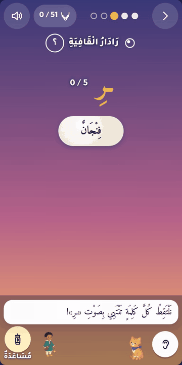
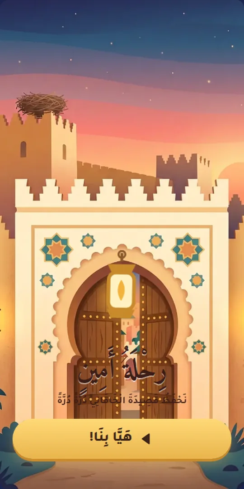
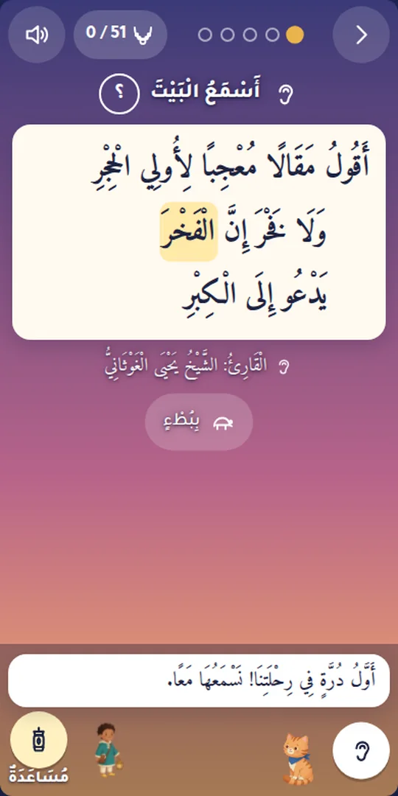
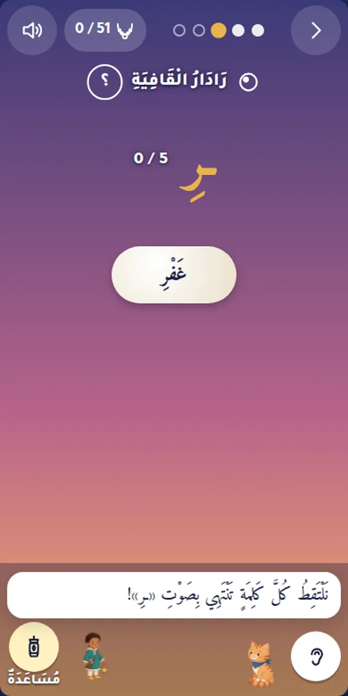
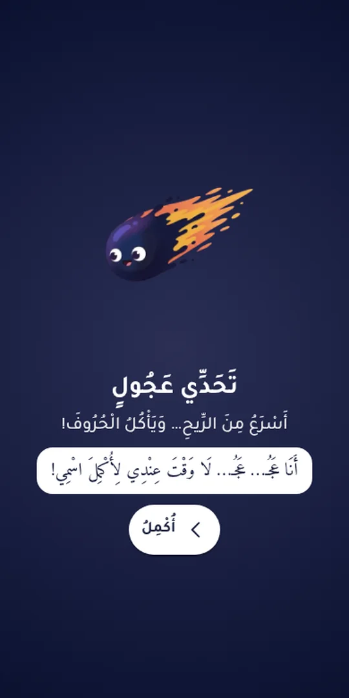
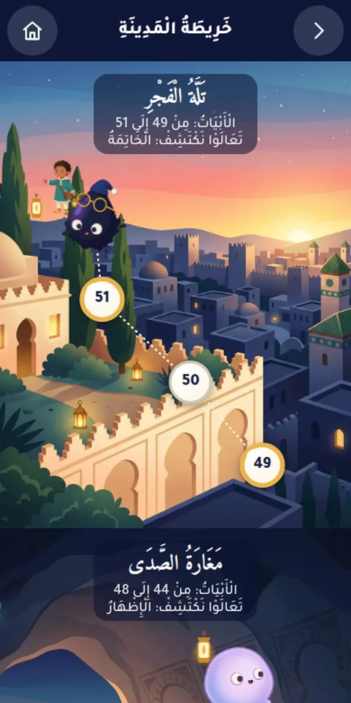
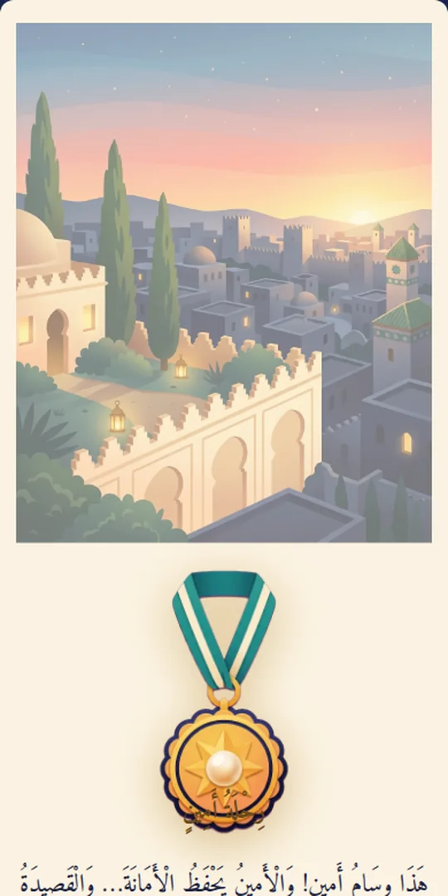

# Amin's Journey in the City of Reciters

[العربية](README.md)

A free Arabic web game for children and families that helps them **learn by heart and understand al-Khāqānīya**. This is
the 51-verse *rāʾiyya* of Abū Muzāḥim Mūsā ibn ʿUbayd Allāh al-Khāqānī (d. 325 AH / 937 CE), whom Ibn al-Jazarī called “the first,
as far as I know, to write on *tajwīd*”, the art of reciting the Qurʾān well.

- **Play:** https://khaqaniya.benjelloun.dev (a parent opens the link)
- **The full poem, vocalised, with meanings and recitation:** https://khaqaniya.benjelloun.dev/qasida/

## What it is

- **Story:** a night walk through ten districts of the City of Reciters, from sunset to dawn. Each verse is a pearl, and
  the necklace is complete at dawn. The cast: Amin, the kitten Mishmish and the stork Laqlaq. Ten members of the Lahn
  gang, each one a recitation mistake, wait at the district gates. They are never beaten, only corrected, and each one
  becomes a friend.
- **Each verse:** listen to it, then light games built on it: echo, the rhyme radar, ordering, and reciting from memory.
  Then a meaning in words a child understands, written from the classical commentaries.
- **Every day:** a one-minute «polish» brings old pearls back before they are forgotten (spaced review the child never sees
  as such). No lives, no clock, no penalty for a day away.
- **Recitation:** the verse audio is Sheikh Yahya al-Ghouthani's vocalised recitation. The text was established from his
  video and checked against printed editions.
- **For grown-ups and teachers:** a grown-up mode with fuller meanings and their sources, a «someone is listening to me»
  mode that shows the text to the person listening, up to forty players («lanterns») on one device, and a printable
  certificate.
- **Respectful by design:** no music, no ads, no accounts, no tracking. Progress stays on the device.
- **Platforms:** an installable PWA that works offline, Arabic and RTL first, built for phones, and usable with a
  keyboard and a screen reader.

## How it was made

- **One text source.** The poem lives in one file, `text/khaqaniya.json`, and the game, the poem site, the video and the
  promos are all generated from it, so a correction lands everywhere at once.
- **Reviewed twice over.** Every Arabic text in the project (the poem's vocalisation, the meanings, the game's copy, the
  video script) was checked by an independent reviewer, with second views from other model families.
- **Sound without music.** Recitation, speech and short non-melodic effects only. The characters' voices are generated
  and are not the voices of real people.
- **Private by default.** The game asks the network for nothing but its own files.
- **Built with AI agents** (Claude Code), with Gemini and GPT models as cross-checks; see [`CREDITS.md`](CREDITS.md).

## Repository

| Path | What |
|---|---|
| `text/` | The one text source (`khaqaniya.json`), kid meanings (`meanings.json`), sources and editions (`SOURCES.md`) |
| `audio/` | Per-verse and per-hemistich recitation clips and their timings (`audio/README.md`) |
| `game/` | The game (Vite + TypeScript, no framework): `npm ci && npm run build` in `game/` |
| `site/` | The poem site, built with [shatr](https://github.com/kmbenjel/shatr) from the same text: `npm ci && npm run build` in `site/` |
| `design/` | Game design, style sheet, all Arabic copy (`copy.ar.json`), decisions |
| `docs/DATA.md` | The data contracts shared by the game, the site and the video |

GitHub Actions builds the game at `/` and the poem site at `/qasida/`, and deploys both to GitHub Pages.

## Credits and licence

See [`CREDITS.md`](CREDITS.md). The code is under MIT ([`LICENSE`](LICENSE)). The recitation audio belongs to its
reciter, is used with credit, and is not covered by the project's licences.

Made for Amin by a relative who loves him.
