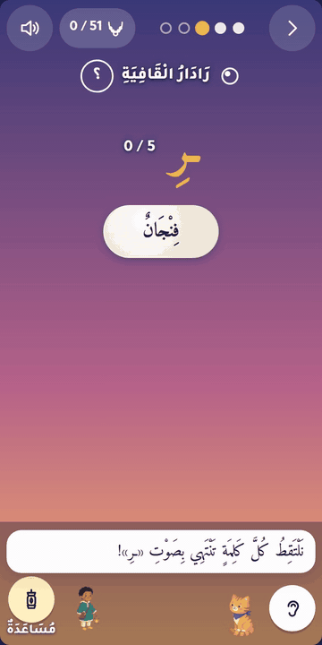
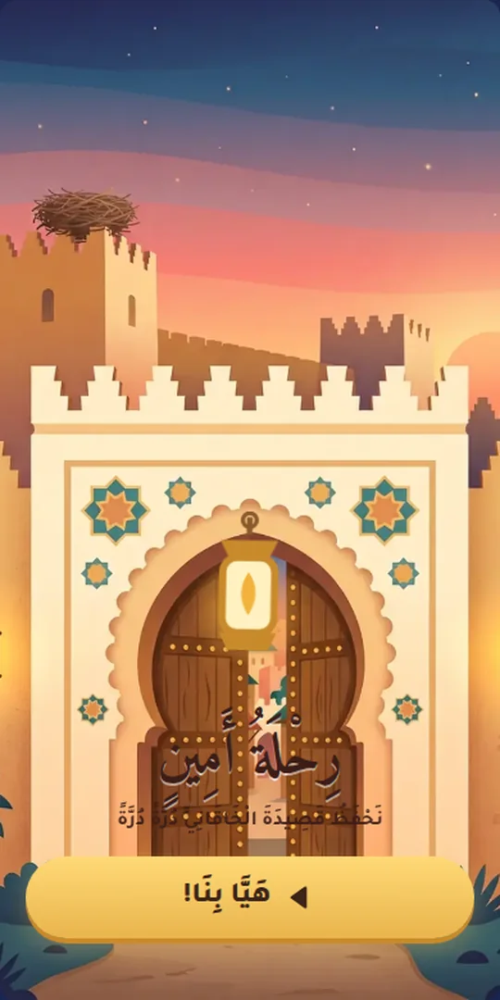
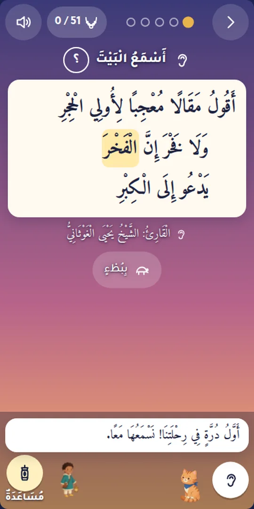
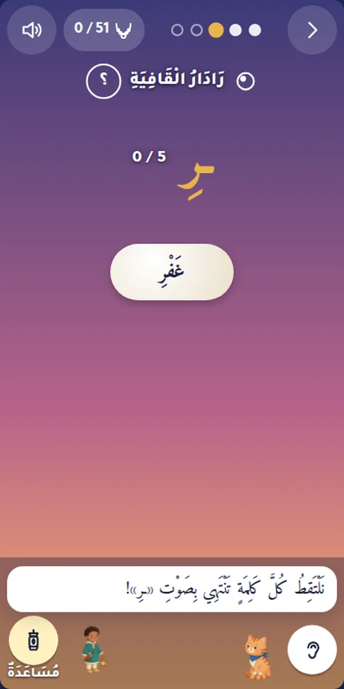
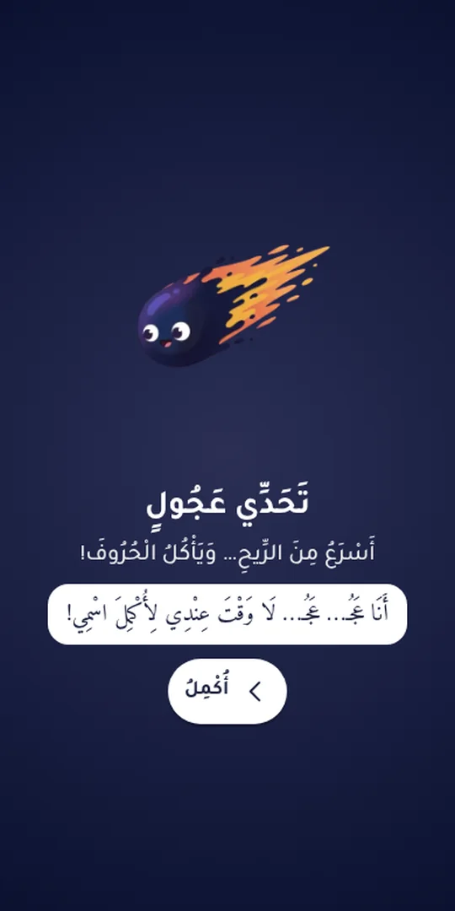
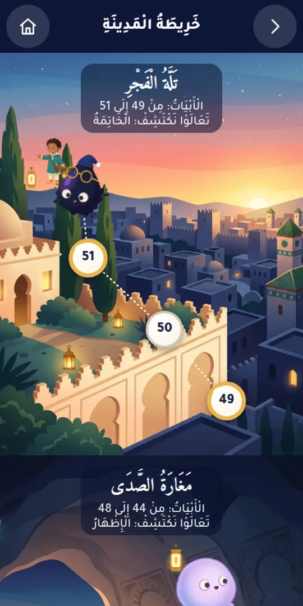
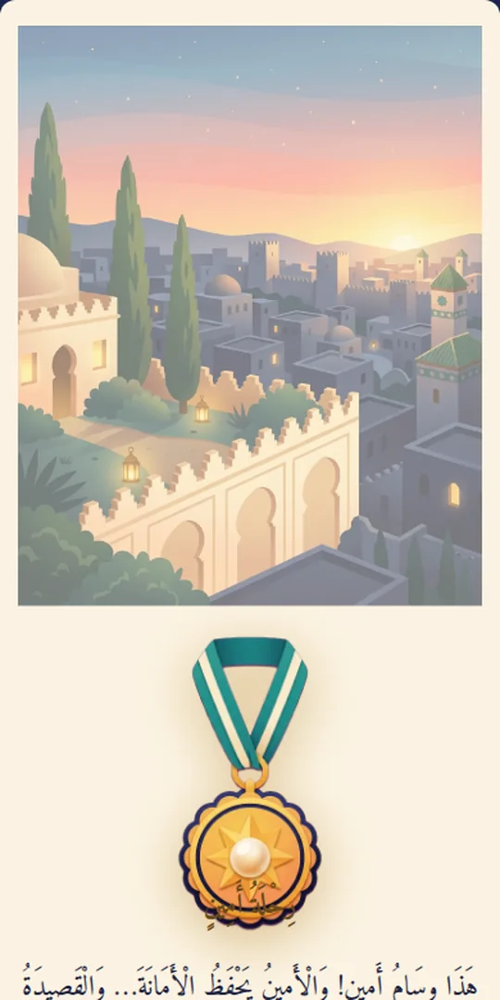

# رِحْلَةُ أَمِينٍ فِي مَدِينَةِ الْقُرَّاءِ

**نَحْفَظُ قَصِيدَةَ الْخَاقَانِيِّ دُرَّةً دُرَّةً**

[English](README.en.md)

رحلة أمين في مدينة القراء: لعبة عربية للصغار والكبار، لحفظ الخاقانية وفهم معانيها، بلا موسيقى ولا إعلانات، وتعمل بلا شبكة.

- **العبوا الآن (يفتح الرابط أحد الوالدين):** https://khaqaniya.benjelloun.dev
- **القصيدة كاملة مضبوطة بالشكل، مع المعاني:** https://khaqaniya.benjelloun.dev/qasida/

## فِي اللُّعْبَةِ

- عشرة أحياء من الغروب إلى الفجر، ودرة لكل بيت، والعقد يكتمل عند الفجر بـ«وسام أمين».
- في آخر كل حي واحد من عصابة اللحن: لا نهزمه، بل نصحح خطأه فيصير صديقا.
- ألعاب قصيرة: أسمع وأختار، الكلمة الهاربة، صياد القافية، أنظم الدرر، من حفظي، قافلة القراء، قبعات الحروف.
- «تلميع» قصير كل يوم: مراجعة للدرر القديمة حتى لا تنسى.
- بلا إعلانات، وبلا موسيقى، وبلا حساب، وتبقى الأسماء والتقدم في الجهاز، وتعمل بلا شبكة بعد أول تحميل.
- للكبار: «وضع الكبار» فيه شرح أوسع مع المصادر، و«معي من يسمعني» لمن يستمع إلى الطفل، ويمكن إضافة أربعين فانوسا على جهاز واحد، يتناوب عليه التلاميذ.

## الْقَصِيدَةُ

الْخَاقَانِيَّةُ، رَائِيَّةُ أَبِي مُزَاحِمٍ الْخَاقَانِيِّ فِي الْقُرَّاءِ وَحُسْنِ الْأَدَاءِ: النَّصُّ كَامِلَ الضَّبْطِ، وَمَعْنَى كُلِّ بَيْتٍ، وَتِلَاوَتُهُ بِصَوْتِ الشَّيْخِ يَحْيَى الْغَوْثَانِيِّ.

قصيدة في 51 بيتا من بحر الطويل، قافيتها راء مكسورة، نظمها أبو مزاحم موسى بن عبيد الله الخاقاني البغدادي (ت 325 هـ)، وقال عنه ابن الجزري: «هو أول من صنف في التجويد فيما أعلم». مطلعها:

<!-- verse:1 (filled from text/khaqaniya.json by promo/tools/social.py) -->
> أَقُولُ مَقَالًا مُعْجِبًا لِأُولِي الْحِجْرِ ‏ ‏ ‏ وَلَا فَخْرَ إِنَّ الْفَخْرَ يَدْعُو إِلَى الْكِبْرِ
<!-- /verse -->

النص المعتمد في [`text/khaqaniya.json`](text/khaqaniya.json)، ومصادره وموازنة النسخ في [`text/SOURCES.md`](text/SOURCES.md).

## كَيْفَ صُنِعَتْ

- **مصدر واحد للنص:** القصيدة في ملف واحد، [`text/khaqaniya.json`](text/khaqaniya.json)، تتولد منه اللعبة وموقع القصيدة والفيديو، فيصل التصحيح إليها جميعا.
- **النص:** ضبط النص كما في تسجيل الشيخ يحيى الغوثاني، مقابلا بشرح أبي عمرو الداني وبطبعات القصيدة المحققة.
- **المعاني** مختصرة للأطفال من شروح القصيدة، والشرح الأوسع ومصادر كل بيت في «وضع الكبار».
- **المراجعة:** كل نص عربي راجعه مراجع مستقل، مع مراجعات ثانية من عائلات نماذج أخرى.
- **الصوت:** تلاوة، وكلام، ومؤثرات صوتية قصيرة فقط. أصوات الشخصيات مولدة آليا، وليست أصوات أشخاص حقيقيين.
- **الخصوصية:** بلا حساب ولا بريد إلكتروني، وبلا إعلانات ولا أدوات تتبع، ولا تطلب اللعبة من الشبكة شيئا غير ملفاتها هي.

## الْمُسْتَوْدَعُ

| المسار | ما فيه |
|---|---|
| `text/` | النص المعتمد ومعاني الأطفال والمصادر |
| `audio/` | مقاطع التلاوة لكل بيت وشطر، وتوقيتاتها |
| `game/` | اللعبة: `npm ci && npm run build` في `game/` |
| `site/` | موقع القصيدة، مبني بـ[shatr](https://github.com/kmbenjel/shatr) من النص نفسه |
| `design/` | تصميم اللعبة، والأسلوب، وكل نصوص اللعبة العربية (`copy.ar.json`) |

## الشُّكْرُ وَالْمَصَادِرُ وَالرُّخْصَةُ

التلاوة في اللعبة بصوت الشيخ د. يحيى الغوثاني، حفظه الله. انظر [`CREDITS.md`](CREDITS.md) للمصادر والخطوط والأصوات والرسوم.
الشفرة برخصة MIT ([`LICENSE`](LICENSE))، وتسجيل التلاوة لصاحبه، ولا تشمله رخص المشروع.

إلى أمين، الذي صنعت هذه الرحلة من أجله، وإلى كل من يمشي معه فيها.

