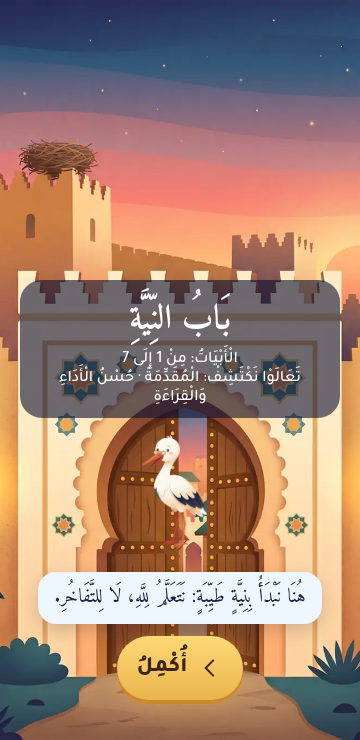
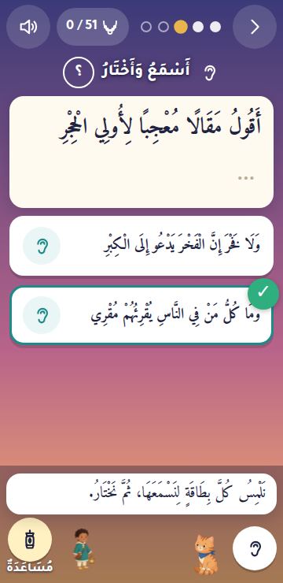
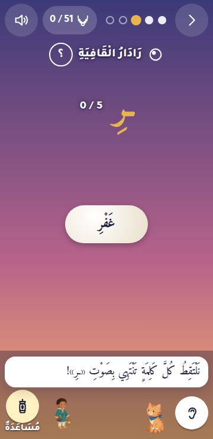
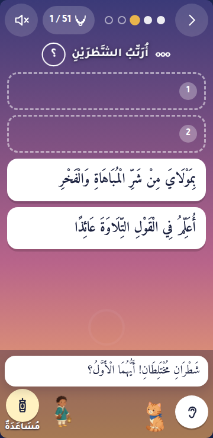
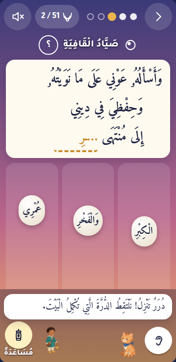
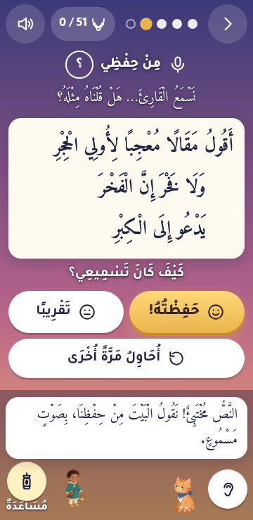
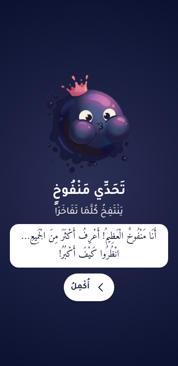
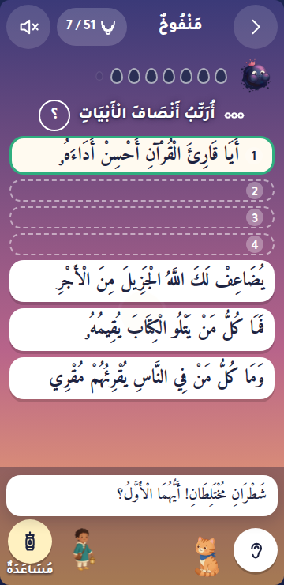
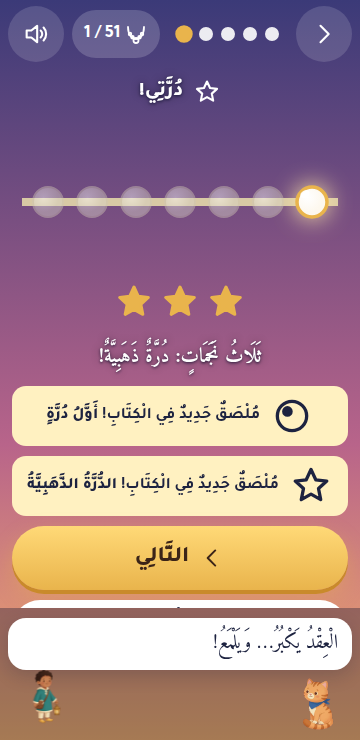
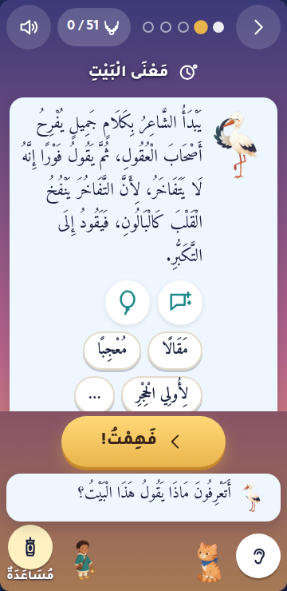

# Q1 — QA, fixes and child-eye playtest (2026-11-13)

Agent «Q1 QA, fixes & child-eye playtest (Opus high)». Everything was built and run on `khaqaniya-vm`
(`scripts/vm.sh run 'cd game && npm ci && npm run build && npx playwright test'`, google-chrome 157, Node 24), with the real
data of the day: `text/khaqaniya.json` (51 verses), `text/meanings.json`, `audio/timings.json` + 153 clips,
`design/copy.ar.json` (842 strings). No voice files exist yet (`audio/voice/`): every character line is a caption only.

## 1. Test results

`npx playwright test` on the VM (round 1 final, 857dad5): **46 passed, 24 skipped**; after round 2 (copy freeze): **52 passed, 30 skipped**, layout audit 0 findings at 4 sizes (the skips are the desktop-only data/long checks in the phone
project), 6.2 min with 8 workers. Phone project 390×844, desktop 1280×800; the layout audit adds 360×740 and 1280×720.

| spec | test | G1 hand-back | now | cause → fix |
|---|---|---|---|---|
| smoke | boots RTL, splash → intro → verse 1, no foreign origin | pass | pass | first launch now goes from the story straight into verse 1 (§1.1) |
| district | district 1 through the UI + its challenge | unfinished (ran forever) | pass ×2 | **test**: `solve()` tapped straight through the terminal item (`boss-done` → next district). Fix: `solve(skip)` for terminal labels; the name sheet answered through the UI |
| games | every mini-game type appears and completes | fail | pass ×2 | **test**: the default `motion=0` made G4 lanes impossible; items were sampled between solves and missed. Fix: `motion=1`, items recorded from `kq:item` events. **game**: weak words marked in a first RECITE were dropped (no verse state yet) → kept until `finishVerse` (087373b) |
| games | polish intervals | fail | pass ×2 | **test**: `solve()` tapped through `polish-done` |
| games | necklace, sheet, qasida links | pass | pass ×2 | — |
| games | finale → prayer → medal → certificate → dedication | unfinished | pass ×2 | **test**: tapped through the finale; **game**: under reduced motion the prayer still had 0.01 ms transitions (rule specificity) → the prayer is now strictly still (087373b); dedication signature checked |
| games | grown-ups gate, settings, reduced motion → G4 still | timeout | pass ×2 | now opens with motion on, so the setting (not the URL) is what is tested |
| poem | whole poem to the medal via the API + on-screen text audit | unfinished (hung) | pass (1.6 min) | **test**: a Playwright click on the closing name sheet waited forever; the audit counted the G1 placeholder «…» as a verse line. Audit result: **0 differences** over every screen of 51 levels, 10 challenges, finale |
| tokens | token audit 200 seeds × 51 verses × 3 levels | pass | pass | 0 violations |
| tokens | silah marks render | pass | pass ×2 | — |
| offline | offline after first load, district 1, `/qasida/` isolation | pass (clip never really checked) | pass ×2 | **test**: the clip check looked for `<audio>` in the DOM (the game uses `new Audio()`), so it always passed; now real playback is tracked (`trackPlayback`) and asserted |
| **qa** (new) | the §13.5 checklist, below | — | 20/20 pass | `tests/qa.spec.ts` |
| **capture** (new) | `__kq.say`, `kq:sfx`, `&timings=`, fresh=1 first-time lines (for V1/V2, `CAPTURE.md`) | — | 4/4 pass | `tests/capture.spec.ts`, 857dad5 |

Test-helper bugs fixed in `src/test-api.ts`: `reset()` now re-applies the URL switches (it silently turned the reciter back
on, making every later level wait for real clips); `active()` exposes the current right/wrong targets; `solve(skip)` can
leave the name sheet to the caller.

## 2. Acceptance checklist §13.5

| item | how | result |
|---|---|---|
| First game within 60 s of the first tap; pearl 1 without reading | `qa` real speed, reciter on, captions only | **pass**: story skipped → first game at **39.5 s**, pearl 1 at 120 s; story watched (captions) → **58.6 s**. ⚠ with voiced intro panels (~30 s) the watched path will pass 60 s (see issues) |
| No dead end: every verse with wrong taps first | `qa` 51 verses, 3 wrong taps on every item, then right | **pass** (51/51) |
| … and with the help lantern only | `qa` 51 verses, help until the answer is shown | **pass** after fix: the rhyme radar and the caravan had no help at all (826558b) |
| No screen shows a verse/hemistich/rhyme word differing by one mark | `poem` audit on every screen, 51 levels + 10 challenges | **pass**: 0 differences (NFC) |
| Locked tokens never options; sacred never wrong options | `tokens` 200 seeds | **pass**: 0 violations |
| Offline after first load: district 1 | `offline` + `qa` (7 levels + challenge offline; 21 clips in cache; v1 clip really plays) | **pass** |
| Offline after «download everything»: whole game | `qa`: all 153 clips in `kq-game-media-v1`, offline v48 plays its clip, v48 level + cave challenge | **pass** |
| 360×740, 390×844, 1280×720, 1280×800: §6 sizes | `qa` layout audit on ~40 screens per size (every text node vs its §6 minimum) | **pass** after fixes (cc4df0a): 13–15 px numbers/notes (map, necklace, stickers, keys, slots, about, heroes) → ≥ 16; beads 22.8 → 24 |
| No clipped tashkeel (line-height) | audit (Amiri text with marks: line-height ≥ 1.75, no overflow clip) + zoomed screenshots of tiles, beads, blanks, lanes | **pass** after fixes: blanks 1.4 → 1.9, headings 1.2–1.6 → 1.8 |
| No horizontal scroll | audit, all screens, 4 sizes | **pass** after fix: the certificate was 540 px too wide on phones (A4 aspect ratio on a flex item) |
| All three sound switches off: instructions understandable | `qa`: first meeting of every game (G1 G3 G4 G4r G5a G6 G7 G8 order S1 S2): banner icon + title + the `.how` caption; «؟» replays it | **pass**; one fix: the district opening line was under the title-card overlay (now on the card) |
| Polish +1/+2/+4/+8 days and back | `qa`: verse 1 due exactly at +1, +3, +7, +15 (not a day before), boxes 2→5, gaps 2/4/8/16; clock back to 0: state identical, polish says «nothing to polish» | **pass** |
| Prayer screen silent and still | `games` finale: no animation/transition, no voice, no effect | **pass** (also under reduced motion now) |
| Bundle grep: no key, no surname, no tracker, no foreign request | `qa`: 19 dist files; key patterns, the child's surname (patterns kept outside the repo, Arabic with harakat stripped and Latin spellings), 11 tracker hosts, live-AI endpoints, absolute fetch URLs; a long session with every screen | **pass** (only data strings: the reciter's YouTube link in timings, the base URL in robots/sitemap) |
| RTL | smoke, screenshots | **pass** (`dir=rtl lang=ar`, trays fill right to left, next arrows point left) |
| Audio: verse/hemistich clips are the right verse | `qa`: 36 `kq:audio` events (verses 1–3) vs the file actually played vs `audio/timings.json` | **pass**: 0 mismatches |
| Media Session in listen-all | `qa`: title = the sadr of the verse playing, artist = reciter, follows to verse 2 | **pass** |
| Keyboard play | `qa`: verses 1–2 with keys only (digits for options/tiles, Tab + Enter for the rest) | **pass** |
| Reduced motion | `qa` with the OS setting (no URL): radar and G4 as still choices, longest animation < 0.01 ms | **pass** |
| Faces flag | owner 2026-11-13 changed it: faces **on**, `faceless` default **off** (724401a); `qa` checks no `.faceless` Amin | **pass** |
| PWA | `tests/pwa-check.mjs` (Chrome's installability API) | installable, 0 errors; offline reload ok |

### Lighthouse 13 (VM, built game served at `/khaqaniya/`)
Lighthouse 12+ has no PWA category; installability is checked above instead.

| | performance | accessibility | best practices | SEO |
|---|---|---|---|---|
| mobile (splash) | 100 (FCP/LCP 1.1 s, TBT 0, CLS 0.002) | 100 | 100 | 100 |
| desktop (splash) | 100 (0.4 s) | 100 | 100 | 100 |

Accessibility on inner screens (capture mode, demo player): home 94 → **100**, map 98 → **100**, verse 100, necklace
98 → **100**, grown-ups 94 → **100**, stickers 94 → **100** after 0c272ad (one `<main>` landmark, lamps `role=img`, white on
teal 4.1:1 → #17706f 5.6:1). Left (weight 0): label/content mismatch on the HUD counter («العقد: 9 من 51» vs «9 / 51»).

## 3. Child-eye playtest

Driver `tests/playtest.mjs` (VM, phone 360×740 at 2×, capture mode, the reciter on, no voice files): districts 1 and 2
(verses 1–11) and both challenges (منفوخ, خلّاط) played through the UI with a visible tap on the right answer, a wrong
tap on every 4th choice, a 600 ms "look" before each tap. Verses 1, 2, 8 and the first challenge at real speed; the others
fast (their clips muted). Timings from `kq:step` / `kq:item` events; screenshots of every step looked at one by one.

**Real-speed numbers** (verse 1, first time): story card 4 s · LISTEN 35 s (nothing to tap for 34 s: whole verse, the
hemistich tip, then the echo of each half) · MEANING (reading time is the child's) · G1 19 s · rhyme radar 26 s · G6 33 s
· RECITE 15 s · reward 5 s → **pearl 1 in about 2½ minutes**. Later verses 2–2½ min; LINK 31–34 s, of which ~20 s were the
two verses replayed back to back after the answer. Challenge 1: 14 questions for 8 drops (every wrong answer comes back),
about 4 minutes. 0 console errors; every tapped target ≥ 56 px except the entrance «skip» (48 px).

**As an 8-year-old.** Fun within 5 seconds: yes, once past the title card: the reciter starts at once and the first game
(listen and pick) is a tap. The rhyme radar is the best moment: big ـرِ, words to catch, the sardine decoy and Mishmish's
«مِيَاوِرِ!» rhyme are funny at this age. Catching falling pearls (G4) is the most "game-like" screen. The gang member's
entrance (منفوخ who inflates when he boasts) reads instantly, and the ink drops washing out are a clear picture of
progress. Boring: the LISTEN step (30+ s with nothing to touch, every level) and the LINK replay (20 s after the answer);
the challenge's last question (rebuild the whole verse, 20+ s) came back a second time after one slip. Confusing: on the
ordering game the cards carried keyboard digits «1»/«2» right next to slots numbered 1/2 (a card marked «1» is not the
first half); in G1's first rung the caption says «tap each card to hear it, then choose» but a tap *chose* the card.
Scary: nothing (the blots are round and sad-faced, not menacing).

**As a parent.** Too much reading? The child never has to read to progress (every line is a caption plus, later, a voice;
big buttons have icons), but without the voice files the captions carry everything, and the kid meanings average 17
words (max 23: v6, v31) — long for a child reading alone; the meaning clips (§3.2) are what will make MEANING work.
Tap targets: big (options 64–76 px, tiles 60 px, lanes full-height). Feedback: right = pop + sparkle + mint card in
< 300 ms, wrong = wobble + thud, the right answer glows after two misses — fast and kind. The help lantern now works in
every game. Respectful: the Qur'anic words stay teal and are never options; the prayer screen is still and silent.

**Quick wins done** (120aae5, 4511712, 9f755c4, 4b6653e): the district opening line now sits on its title card (it was hidden
under the overlay: with no voice the child saw nothing); on phones the play frame is exactly one screen high so the ear,
the help lantern and the caption never scroll away, and the primary «next» sits in the cast bar (a long meaning hid it); keyboard digits hidden on touch screens; the HUD necklace now ticks
when the pearl lands (it stayed at 0/51 on the reward); the two-verse replay after LINK can be skipped and the options
appear while the previous verse plays (no 10 s wait); the challenge's last question is not repeated for one slip; audio
cards (G1 rung 1) work as the caption says: the first tap plays the card and marks it ✓, a second tap chooses; small
buttons raised to 56 px; the falling radar words were white on cream (now ink); the entrance and finale «skip» buttons now say «أُكْمِلُ» (they said «أَحْفَظُهُ», "I know it by
heart", which is the grown-up «I know it» key).

Screenshots (`qa-shots/`, phone 360×740):

| | |
|---|---|
|  |  |
|  |  |
|  |  |
|  |  |
|  |  |

## 4. Bugs found → fixed

| bug | where | commit |
|---|---|---|
| Weak words marked in the first RECITE («someone is listening») were lost | game | 087373b |
| Prayer screen kept 0.01 ms transitions under reduced motion | game | 087373b |
| Step dots aria-label always «step 1 of 5» | game | 087373b |
| Faces: owner's decision, `faceless` default off | game | 724401a |
| No help lantern in the rhyme radar (tutorial) and the caravan (S1) | game | 826558b |
| Test API `reset()` turned the reciter back on | test API | 826558b |
| Certificate wider than a phone (540 px horizontal scroll, blank screen) | game | cc4df0a |
| §6 sizes: 12–15 px text on map, necklace, stickers, slots, keys, notes; beads 22.8 px | game | cc4df0a |
| Harakat line-heights 1.2–1.6 on Amiri headings, blanks, logo, medal | game | cc4df0a |
| Four ordering cards (challenge G2 rung 2) pushed the 4th card and the cast bar below the fold on phones | game | cc4df0a |
| «Compare» line in RECITE at 16 px adult size although the child reads it | game | cc4df0a |
| First launch: story → home → another tap before verse 1 (§1.1 says story → verse 1) | game | cc4df0a |
| Lighthouse a11y: no `<main>`, `aria-label` on a plain div, 4.1:1 contrast on selected chips/tabs | game | 0c272ad |
| Test helpers: race through terminal items, motion off, hung name-sheet click, playback never checked, placeholder audited as verse | tests | 087373b, cc4df0a |
| District opening line hidden under its title card (invisible without voice) | game | 120aae5 |
| Phone frame grew with its content: cast bar, ear and help lantern scrolled off screen | game | 120aae5, 4511712 |
| Keyboard digits on ordering cards read as slot numbers on phones | game | 120aae5 |
| HUD necklace stayed at the old count on the reward | game | 120aae5 |
| LINK: 10 s before the options, 20 s unskippable replay after | game | 120aae5, 4511712 |
| G1 rung 1: a tap chose the card although the caption says «tap to hear» (design: tap to hear, ✓ to choose) | game | 4511712 |
| Challenge: the last whole-verse question repeated after a single slip | game | 4511712 |
| Small buttons 48 px (< 56, §8.4); entrance/finale skip labelled «أَحْفَظُهُ» (the grown-up «I know it») | game | 4511712 |
| Rhyme radar (motion on): falling words white on cream, unreadable | game | 9f755c4 |
| Long meanings pushed «فَهِمْتُ» below the fold on phones: the primary «next» now sits in the cast bar above the caption | game | 4b6653e |

## 5. Remaining issues (ranked)

1. **Copy for A1** (not edited here): `cert.print.hint` «للطباعة: ورقة A4 بالعرض.» has no tashkeel; `finale.dua.text`
   is 16 words (§6.5 says ≤ 14 per bubble; it is a single still screen, so maybe fine); `btn.skip` «أَحْفَظُهُ» fits only the
   grown-up «I know it» (now used only there); the reciter credit comes from `audio/timings.json` without tashkeel
   («الشيخ يحيى الغوثاني», L1/G2 data).
2. **Kid meanings are long to read alone** (M1b): 17 words on average, 21–23 on v1, v6, v11, v31, v34. The meaning clips in
   Laqlaq's voice (§3.2, TTS) are what makes MEANING work for a non-reader; until then it is the slowest screen to read.
3. **No voice files yet**: every line is a caption. With voiced intro panels (~30 s) a child who watches the whole story
   reaches the first game after ~70 s (§13.5 says 60 s; skipping, 40 s). Option for D1/owner: a shorter intro (4 panels)
   or the first game earlier in verse 1.
4. **LISTEN is 30–35 s with nothing to touch**, every new verse (whole verse + echo of each half). It is the learning core,
   but it is where an 8-year-old will look away. Ideas (D1): a tap-along (tap the glowing word) during the echo, or the
   echo only for the first verse of each district.
5. **Challenge ordering with four cards** (G2 rung 2) still needs a short scroll inside the stage at 360×740 (the cast bar
   stays visible now). A 3-card variant on small phones would avoid it.
6. **Emoji paw prints** in G3 (🐾) render as boxes where no emoji font exists (seen on the VM's Linux); fine on phones, an
   SVG would be safer.
7. **A11y leftovers** (Lighthouse): label/content mismatch on the HUD counter and gate nodes; the «ear» on option cards is
   a `span role=button` inside a `<button>` (not focusable on its own; the keyboard hears via the card's first tap now).
8. **Reward screen**: the pearl flies away after 0.9 s, leaving a large empty area above the stars; a pearl settling on a
   small necklace there would be juicier.
9. **Gang challenge length** grows with wrong answers (each comes back): 14 questions for 8 drops in the playtest at 25 %
   wrong taps, about 4 minutes; design says 2–3.
10. Tests: the layout audit checks sizes, line-heights and overflow, not colour contrast of moving pieces (the white
    radar words were caught by eye); Lighthouse checks contrast only on still screens.

## 6. Round 2 (2026-11-13 evening)

### A. Fixes from the remaining list, R1's art, V2's bugs
- **LISTEN** (30–35 s with nothing to touch): the lit word can be caught (tap: a star sparkle and a star count, no
  score, nothing to lose); on a verse already heard once, «next» is offered while the echo runs (the echo stops
  cleanly). **Intro**: one tap (or «next») per panel, the voice stops; «skip all» stays at the top.
  **Four/five ordering cards** fit 360×740 above the cast bar (slim empty slots, compact challenge head, G9 cards two per
  row); `qa` measures every ordering question with 4+ cards over two seeds. **Paw prints** are inline SVG.
  **Reward**: the pearl lands on the district's strand (won pearls lit, the new one glowing).
- **R1's art** (0fee3c6) wired in: manifest merged into `data/art.json` (faces on), prepare-data copies only the files
  in use (63 + 22 @2x, 2.44 MB of the 3 MB budget, no faceless set), `srcset` 1×/2×, the game's poses mapped to the
  drawn ones, intro panels, medal (medal screen, certificate, sticker), share-card backgrounds, the reciter lantern
  (recoloured per reciter), Amin turned to face the play in the cast bar, Khafiyy's near-invisible gag and Manfoukh's
  deflating kept with opacity/scale, an image that fails to load falls back to its SVG. The service worker precaches
  district 1's pictures (characters, intro, the gate band, Manfoukh); «download everything» fetches all 85 pictures
  (tested offline). Layout audit at 4 sizes: 0 findings.
- **V2's bugs**: the sardine joke never fired (the test ran on vocalised text) → compared without marks
  (`stripMarks`, U+0610–061A, 064B–065F, 0670, 06D6–06ED), also in the still radar; tested both ways. Grep found no
  other test on vocalised text. The vocalised reciter credit now uses the verse face at 18 px, line-height 1.8, wraps.

### B. Child-view pass (Gemini 4 Argon on Vertex, `reviews/argon/child_view.md`)
17 phone screenshots (390×844 → 780 px JPEG q85) with R1's art; prompt `reviews/argon/child_view_prompt.md`.
Applied (visual/layout only):

| finding (screen) | verdict | change |
|---|---|---|
| counters read «51 / 9», «5 / 0» (RTL reorders them) (02, 05, 08…) | sound | HUD, radar and star counters set LTR like a school mark: «9 / 51» |
| the slow toggle's native box looks like a broken picture (05) | sound | a pill toggle (turtle + word), lit gold when on |
| stickers announced as text only (10) | sound | each «new sticker» banner shows the sticker's art |
| the reward strand wrapped one pearl under the thread (10) | sound | pearls 40 px, one row for 7 |
| empty ink drops left after the correction (15) | sound | the meter is hidden once he is corrected |
| tiny duplicate Amin in the home cast bar (02) | sound | no characters in the home cast bar |
| locked map pearl «11» unreadable on the bright art (03) | sound | a dark disc behind locked pearls, white number |
| certificate field repeats its label as placeholder, colon misplaced (17) | sound | placeholder removed (the label is above) |
| meaning card overloaded (06) | sound, design-level | not changed now (pictos + chips + lesson are §4.2); proposal for D1: chips behind «…» on phones |
| no forward button while listening (05) | by design | «next» comes after the echo (and now earlier on a heard verse) |
| four slots vs «two half-verses» title (14) | copy | to A1 (a rung-2 title key is needed) |
| ears missing on challenge cards (14) | not a bug | ears show when the reciter is on (the shots were taken with it off) |
| lanes vs basket affordance (12) | can't judge still | animation shows the falling pearls; kept |
| necklace gold vs grey rings (16) | minor | gold = 3 stars (golden pearl); a legend would be copy |

**Copy suggestions passed to the coordinator (for A1)**: home subtitle «الْخَاقَانِيَّةَ» is opaque to a child; the home
greeting; the district «فِي الْقَصِيدَةِ: …» line reads like a syllabus; radar «رَاءٌ مَكْسُورَةٌ» (grammar words);
«شَطْر» never explained (pair once with «نِصْفُ الْبَيْتِ»); G2 rung 2 shows four hemistichs under «أُرَتِّبُ الشَّطْرَيْنِ»;
necklace «بِلَا مُؤَقِّتٍ»; certificate label; intro «نَظَمَ»; plus `cert.print.hint` without tashkeel and the 16-word prayer.

### C. Code / a11y review (GPT-5.6 Luna via Copilot CLI, `reviews/luna/code_a11y.md`)
Run from a scratch copy of `game/` (no node_modules, dist, art) with read-only shell tools (write denied). Every claim
checked in the code; verdicts and fixes (10aa48b = before the capture freeze, visual-neutral or visual; CFIX = after):

| # | claim | verdict | fix |
|---|---|---|---|
| A1 | no focus management after a route change | **real** | the new screen root takes focus (`tabindex=-1`, no ring) — 10aa48b |
| A2 | sheets: no label, no focus trap, no focus return; router removes them without close() | **real** | `aria-labelledby` (title or first line), Tab trapped, Escape, focus back to the opener, router calls `close()` — 10aa48b |
| A3 | option «ear» = span role=button, not focusable, label «ear» in English | **real** | `tabindex=0`, Enter/Space, `aria.ear` label (G1 cards and ordering pieces) — 10aa48b |
| A4 | game keys fire while typing in a field | **real** (low) | `typing(e)` guard in every game key handler — 10aa48b |
| A5 | targets under 56 px (how «؟» 40, ears 48, map rail 34) | **real** | invisible hit areas ≥ 56 px, same look — 10aa48b |
| A6 | OS reduced-motion change not followed while open | **real** | `matchMedia(...).addEventListener('change')` — 10aa48b |
| A7 | step progress only visual | partly | dots' label already follows the step (087373b); banner `aria-live=polite` — 10aa48b |
| A8 | white text on light skies | **real** on sunset/dawn bottoms | soft dark text-shadow on the frame's white texts — 10aa48b |
| A9 | lane keys vs RTL order | not a bug | ←/→ move the basket visually (lane 0 is the right one in RTL, the basket is placed with `inset-inline-start`) |
| O1 | data cache `-v1` serves old data after an update | **real** | data cache named per build; old ones deleted on activate — CFIX |
| O2 | media cache never refreshes a changed clip/picture | **real** | media cache named by the hash of every shipped clip and picture (`build.json` `media`): a changed set is fetched again — CFIX |
| O3, O5 | a quota error on `cache.put` turns a good response into an error | **real** | puts in their own try; the response is served anyway — CFIX |
| O4 | partial install treated as success | **real** | a missing shell/data file fails the install (the old worker stays); clips and pictures may come later — CFIX |
| O6 | impossible Range → 206 with a bad body | **real** (low) | 416 with `Content-Range: bytes */size` — CFIX, tested |
| O7 | navigation fallback depends on the root being cached | covered by O4 | `./` is precached and required |
| M1 | voice keeps playing after leaving a screen | **real** | router stops the voice — 10aa48b |
| M2 | sheet Escape listeners leak | **real** | see A2 — 10aa48b |
| M3 | ducking stays on after an aborted line | **real** | `setDuck(false)` on abort and in `stopVoice()` — 10aa48b |
| M4 | Media Session handlers kept after the necklace | **real** (low) | cleared on leaving — CFIX |
| M5 | timers outliving their screen | mostly harmless | the long ones (levels, bosses, finale) use the screen's AbortSignal; the short UI ones touch detached nodes only |
| M6 | object URLs never revoked | **real** (low) | revoked after 10 s (export, share image) — CFIX |
| M7 | Web Audio nodes not disconnected | not a leak | one-shot sources stop and are collected |
| E1 | a malformed optional file (`{}`) crashes boot | **real** (low) | wrong-shaped meanings/timings/meaning-audio/voice files count as absent with a warning — CFIX |
| E2 | malformed world → crash | by design | required file: the error screen with «reload» |
| E3 | import accepts loose profiles | real (low) | not changed: import is a grown-up tool; noted |
| E4 | «download everything» says done after failures | **real** | it now reports the percentage actually cached and can be pressed again — CFIX |
| E5 | audio failure plays silently | by design | the level keeps its rhythm (silent timing); kq:audio still fires |
| E6 | storage failure is silent | **real** | A1's `error.storage.kid` on home and `error.storage` in the grown-ups' corner when a write fails — CFIX, tested with storage blocked. Found on the way: `sessionStorage.setItem` outside a try **crashed the boot** when storage is blocked (Safari private mode) → a never-throwing `session` helper — CFIX |
| C1 | `:has()` layouts break on Chrome < 105 / iOS < 15.4 | **real** | class rules (`words`, `some`/`many`, `many-cards`); only the pill toggle's gold background still uses `:has` (fallback: gold text) — 10aa48b |
| C2 | `100dvh` unsupported on older browsers | **real** | `100vh` declared first everywhere — 10aa48b |
| C3 | `text-wrap: balance` | not a bug | progressive enhancement |
| C4 | iOS audio unlock | partly | unlock on the first tap (splash) already; nothing changed |
| C5 | `preservesPitch` unguarded | not a bug | an assignment to an unknown property is harmless |
| C6 | no iOS install guidance | **real** | A1's `app.install.ios` in the grown-ups' corner, only on iOS when not installed — CFIX, tested with an iPhone UA |
| — | (Q1) `translate` property on the radar words (Chrome < 104) | **real** | centred with `margin-inline: auto` — 10aa48b |

### Copy round (A1, 9b759c2, COPY_REVIEW §8)
Nine changed strings come in through the build. Four new keys wired: `game.orderHalves.many` (G2 title when four or more
hemistichs show), `btn.help.label` (a one-word label under the help lantern; the button keeps its aria-label; the
four-card fit still holds: 12–55 px to spare at 360×740), `error.storage.kid` / `app.install.ios` (above). Test:
`qa` «copy round».
